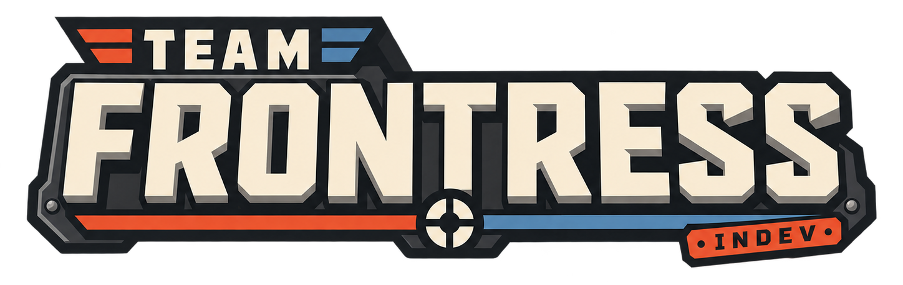

<div align="center">

[]()

### ONE WAR. THOUSANDS OF BATTLES.

**A Team Fortress 2 mod where every match is a piece of one big RED vs BLU war.*
> btw we've added Easy Anti-Cheat... so my dear cheaters - exit is there!

[Воу! Русский язык поддерживается](README_RU.md)

</div>

---

With this mod I want to fix a problem almost every matchmade game has: **no match means anything**. You play, the scoreboard closes, it's gone.

I want something else. I want the community to live right in the lobby. I want you to log in and get that warm feeling of coming back to people you know. You should see how many people are playing and feel that things are happening in the background. That's how it was on my servers back in the Source days. Good times.

The inspiration is Helldivers 2™, Frontline and other games with a global story, where what players do actually matters and moves the story forward. I think that's cool.

---

## So what is this

Short version: the shooting is the TF2 you know. Everything around it is new:

- **Easy Anti-Cheat instead of VAC.** I've heard of cheaters problem?
- **The war.** Every match feeds one campaign on a map of sectors. A win pushes an offensive forward, a loss pushes it back. Clear the last stage and the sector is yours, and the front moves.
- **Our own coordinator** instead of Valve's: matchmaking, parties, lobbies, servers.
- **Clans** with levels, perks and their own banner on the war map.
- **Chat and "who's online"** right in the main menu.
- **Quests**, a career page, match results.
- **A ton of new UI.** Every menu and HUD was rebuilt from scratch.

The screenshots on the Steam page show it best. It's cool! Right? ..right?

I'm building the global systems first: matchmaking, the war, clans, lobbies, servers. Gameplay comes after. There are already some gameplay changes, though, thanks to Team Comtress 2. More on them below.

---

## Thanks, Team Comtress 2

This project is a fork of [Team Comtress 2](https://github.com/mastercomfig/tc2) (TC2), so a lot of great stuff is already here. Great people. Their goal is to fix TF2's bugs, make it faster and add quality of life, so that Valve can eventually pull it into the real game.

What we got from them (a small part: they have over two thousand commits):

- **Hundreds of bug fixes**, from the camera locking up when you join a lobby while being revived to robot engineers that wouldn't remove sappers.
- **Performance**: faster menus (in game too), item and player lookup optimizations, fixes for threaded rendering.
- **Subtick aim.** When you fire, the server uses your aim between ticks rather than at the start of the tick. That's theirs.
- **Quality of life**: a reworked crosshair, proper glow outlines on items and flags, a match HUD, FOV fixes for different aspect ratios, a server browser search that works.
- **Matches**: a reworked casual map timer, guards against matches that drag on forever, stopwatch fixes, bots in casual.
- **Balance** (a separate experimental track at TC2): demoman charge turning, Hot Hand, Powerjack, a new parachute, Scottish Resistance, flamethrower.
- **MvM**: dozens of fixes to robots, tanks and the HUD.

---

## What we built

### **Easy Anti-Cheat instead of VAC.** 

The integration is still in progress and we are experimenting with it. There are A LOT OF CONCENRS arount it. BUT!
TF2 has cheaters problem, if we could solve it - we are cool. So let's test it.

### Our own coordinator (GC)

Valve has a Game Coordinator: the service TF2 uses to find matches. The public SDK doesn't include it, so we wrote our own in Go: [`services/gc`](services/gc).

The game thinks it's talking to Valve's coordinator: same protocol, same messages. So the stock windows just work: the party panel, "match found", leaving a match, the results.

What it does:

- **Matchmaking**: parties are never split, teams are balanced by size and rating, and the map is voted on or picked from the ones that haven't been played in a while.
- **Regions: RU/Asia, EU/Germany, NA/Canada.** Your game pings our servers itself, and a match only goes to a server every player reaches with a decent ping. No more "Russia to Canada without a VPN". You can pick a region by hand on the play screen, which also shows your ping to each.
- **Back-to-back matches**: after a map the lobby rolls on to the next one, with no new search.
- **A server pool**: a match only forms when there's a free server. No "match found" with nowhere to play.
- **Abandons, reports, match history.** Webhooks let websites and Discord bots hear about matches and the war.
- **[mm.team-frontress.org](https://mm.team-frontress.org)**: every match with its scoreboard, every player's record, and your own account: quests and whether you can queue. Moderators review reports, ban and end stuck matches there. It is the coordinator's admin panel ([tf2pickup-frontress](https://github.com/gru2007/tf2pickup-frontress)); in the game it is under Career and Settings.
- Every step has a deadline. Nothing waits forever (in theory).

### The war

- **A map of sectors.** A sector isn't one map but a whole operation: a breakthrough on 5CP → an advance on Payload → an assault on A/D → sector captured.
- **The war gets wider with the player count.** Few players means one front, more players means several. Even eight people should feel like they're fighting a war, not sitting on empty servers.
- **Sides.** At the start of a campaign you pick RED or BLU, and you stay with them until it ends.
- **Battle conditions**: no crits, low gravity, grappling hooks, long or short respawn waves.
- **Orders**: a battle on the war's order pays bonus XP to everyone in it, win or lose.
- **The war feed.** The global chat shows who won which battle, which sector fell and who won the campaign. A new campaign starts a day after the last one ends.

### Clans

A clan is more than a tag. You play, and your clan levels up, faster when you play with clanmates. Levels unlock perks: bonus XP for playing with clanmates, the clan's banner on the war map over the sector it fought hardest for, a weekly clan contract, the clan's own order, and a bigger roster. At the top level, the war feed names your clan when its sector falls.

### Lobby and social

- Global, clan and party chat right in the main menu.
- You can see who's online and what they're doing: searching, in a match, in the menu.
- A "looking for a squad" button.
- Pop-ups for things that happen: a clan invite, a report that was acted on.

### Progress

- **Quests**: three a day and one a week. Progress comes from the match results: kills, damage, healing, wins, classes played.
- **Career and match results**: XP, levels, rating.
- **Rating (Elo).** There's no ranked mode for now. Elo is there to make the teams even. How it works: everyone starts at 1500 and is measured against the other team's average rating. Beat a stronger team and you gain a lot; lose to a weaker one and you lose a lot. For your first 10 matches your rating moves twice as fast (K = 32, then 16), so it finds your level quickly.

### Frontress UI

Every menu and HUD is new and built on [RmlUi](https://github.com/mikke89/RmlUi) (HTML/CSS, but inside the game). It's not VGUI and not Steam's built-in browser. The screens: home, play, war, clan, career, quests, locker, classes, teams, results, support and pause. There are two HUDs to choose from, full and minimal. It all lives in [`game/tc2/loose/resource/fui`](game/tc2/loose/resource/fui) and can be edited without rebuilding the game.

### Everything else

- **64 tick** (stock is 66). Nothing fancy, just a round number.
- **A native macOS (Apple Silicon) build** with Metal. It's for development only for now due to legal reasons; players get Windows and Linux.
- **A "Support us" tab** using Steam microtransactions. You might get a badge and definetly our thanks, nothing pay-to-win.

---

## What it adds up to

You log in one evening. There are already twenty people in chat, and someone from your clan invites you to a party. On the war map BLU is pushing on the Foundry, and tonight there's a battle there on orders. You hit Play, and a minute later you're on Payload, one stage of the offensive. You win: the offensive moves, a line shows up in the feed, your clan gets XP and a quest is done. The next map rolls in on its own.

Every match means something. That's the whole idea.

---

## What's not there yet (honestly)

- **Ranked.** Only casual and the war.
- **A big player base.** It's a small project, and everything is designed to be fun with ten people.
- **A finished anti-cheat.** EAC is being wired in but hasn't been tested in production yet.
- There isn't much gameplay of our own beyond TC2 yet. There will be.

---

## For developers

```text
src/                         the game (Source SDK 2013 + TC2 + ours)
services/gc/                 the coordinator, in Go
game/tc2/loose/resource/fui/ Frontress UI: screens, HUDs, styles, translations
deploy/frontress/            how to run it all on a server
site/                        team-frontress.org, the landing page (Cloudflare Workers)
```

- Run the coordinator locally: `cd services/gc && make run`. Details in [`services/gc/README.md`](services/gc/README.md).
- Servers and deployment: [`deploy/frontress`](deploy/frontress).
- Building on macOS: [`DEVELOPMENT_MACOS.md`](DEVELOPMENT_MACOS.md).
- Player builds (Windows, Linux) come from CI.

We need help everywhere: bugs, testing matchmaking with different player counts, checking servers, UI, maps. Before a big PR, talk to us first, so you don't rebuild something we already threw out.

---

## Thanks

**Valve** for Source and TF2, the **Team Comtress 2** team for the foundation, and everyone who shows up to playtests.

## Legal

Valve, Steam, Source, Team Fortress and related names, logos and assets are trademarks and/or registered trademarks of Valve Corporation.

Team Frontress is a community project and is **not sponsored, endorsed, licensed by, or affiliated with Valve Corporation**.

Source SDK-derived code in this repository is distributed under the terms in [`LICENSE`](LICENSE) and the accompanying third-party notices.

---

<div align="center">

`RED` **────── ⚔ ──────** `BLU`

<sub>P.S. Someone on the team should rewrite this. Is this even a README?</sub>

</div>
