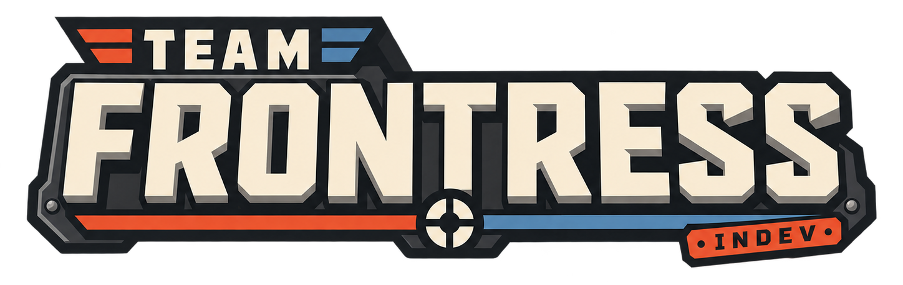

<div align="center">

[]()

### ОДНА ВОЙНА. ТЫСЯЧИ БОЁВ.

**Мод для Team Fortress 2, где каждый матч — кусочек одной большой войны RED против BLU.**
> кстати... мы добавили Easy Anti-Cheat, так что дорогие читеры - выход там!

[English version](README.md)

</div>

---

С помощью этого мода я хочу решить проблему, которая есть почти во всех играх с матчмейкингом: **каждый матч ничего не значит**. Отыграл, табличка закрылась, всё забыто.

А хочется по-другому. Хочется, чтобы комьюнити жило прямо в лобби. Чтобы после входа было тёплое ощущение: ты вернулся к людям, которых знаешь. Видно, сколько народу в игре, и на фоне что-то происходит. Так было на моих серверах в Source-играх — хорошее было время.

Ориентиры — Helldivers 2™, Frontline и другие игры с глобальной сюжеткой, где активность игроков что-то значит и двигает историю. Думаю, это круто.

---

## Что тут вообще происходит

Если коротко: стрельба — та же TF2, которую вы знаете. А вокруг неё — новое:

- **Война.** Все матчи складываются в одну кампанию на карте секторов. Победа двигает наступление, поражение откатывает. Взял последний этап — сектор твой, фронт сдвинулся.
- **Свой координатор** вместо Valve: матчмейкинг, пати, лобби, сервера.
- **Кланы**, у которых есть уровни, перки и свой флаг на карте войны.
- **Чаты и «кто сейчас онлайн»** прямо в главном меню.
- **Квесты**, карьера, итоги матча.
- **Тонна нового UI.** Все меню и HUD переделаны с нуля.

Скрины лучше всего смотреть на странице в Steam. Это круто! да? ..да?

Сначала я занимаюсь глобальными системами: матчмейкинг, война, кланы, лобби, сервера. Геймплей потом. Но по геймплею уже кое-что есть — спасибо Team Comtress 2, о них ниже.

---

## Спасибо Team Comtress 2

Этот проект — форк [Team Comtress 2](https://github.com/mastercomfig/tc2) (TC2), так что куча крутых штук уже здесь. Крутые парни. Их цель — чинить баги TF2, ускорять игру и добавлять удобства, чтобы потом это забрала сама Valve.

Что мы получили от них (это малая часть, у них больше двух тысяч коммитов):

- **Сотни багфиксов** — от зависшей камеры при входе в лобби во время воскрешения до роботов-инженеров, которые не снимали жучки.
- **Производительность**: быстрее меню (в том числе в игре), оптимизации предметов и поиска игроков, правки под многопоточный рендер.
- **Subtick для прицела.** В момент выстрела сервер берёт угол прицела между тиками, а не по началу тика. Это от них.
- **Удобства**: переделанный прицел, нормальная обводка (glow) у предметов и флагов, HUD матча, правки FOV под соотношение сторон, починенный поиск в браузере серверов.
- **Матчи**: переделанный таймер карт в казуале, защита от бесконечно затянутых матчей, правки stopwatch, боты в казуале.
- **Баланс** (у TC2 это отдельная экспериментальная ветка): рывок демомена, Hot Hand, Powerjack, новый парашют, Scottish Resistance, огнемёт.
- **MvM**: десятки исправлений роботов, танков и HUD.

---

## Что сделали мы

### **Easy Anti-Cheat вместо VAC.** 

Интеграция ещё в процессе и мы экспериментируем с ней. Просто... в сети много споров про античиты, НО!
В TF2 проблема читеров стоит остро - так что если мы решим её, то будет круто! Давайте тестировать!

### Свой координатор (GC)

У Valve есть Game Coordinator — сервис, через который TF2 ищет матчи. В публичном SDK его нет. Мы написали свой, на Go: [`services/gc`](services/gc).

Игра думает, что разговаривает с координатором Valve: тот же протокол, те же сообщения. Поэтому стоковые окна работают как есть — пати, «матч найден», выход из матча, итоги.

Что он умеет:

- **Матчмейкинг**: пати никогда не разбиваются, команды выравниваются по размеру и рейтингу, карту выбирают голосом или берут ту, что давно не играли.
- **Регионы: RU/Asia, EU/Germany, NA/Canada.** Игра сама пингует наши сервера, и матч собирается только на том, до которого достают все игроки, с нормальным пингом. Никаких «из России в Канаду без VPN». Регион можно выбрать руками на экране «Играть», там же виден пинг до каждого.
- **Матчи без перерыва**: после карты лобби едет на следующую, не надо заново искать.
- **Пул серверов**: матч собирается, только если есть свободный сервер. Никаких «матч найден» в пустоту.
- **Ливеры, жалобы, история матчей.** А через вебхуки сайты и Discord-боты узнают о матчах и о войне.
- **[mm.team-frontress.org](https://mm.team-frontress.org)**: все матчи с таблицами результатов, профили игроков и ваш аккаунт — задания и можно ли вам искать матч. Модераторы там разбирают жалобы, банят и завершают зависшие матчи. Это админка координатора ([tf2pickup-frontress](https://github.com/gru2007/tf2pickup-frontress)); в игре — в «Карьере» и «Настройках».
- У каждого шага есть дедлайн. Ничего не висит вечно (ну, в теории).

### Война

- **Карта секторов.** Сектор — это не одна карта, а целая операция: прорыв на 5CP → продвижение на Payload → штурм на A/D → сектор взят.
- **Ширина войны зависит от онлайна.** Мало людей — один фронт, больше — несколько. Даже восемь человек должны чувствовать, что воюют, а не сидят по пустым серверам.
- **Стороны.** В начале кампании выбираешь RED или BLU, и до конца кампании ты за них.
- **Особые условия боя**: без критов, низкая гравитация, крюки, длинные или короткие волны респавна.
- **Приказы**: бой по приказу даёт бонус к опыту всем участникам, выиграл ты или нет.
- **Лента событий.** В общем чате видно, кто где выиграл бой, какой сектор пал, кто выиграл кампанию. Через сутки после конца кампании начинается новая.

### Кланы

Клан — это не просто тег. Играешь — клан качается. С клановыми вместе — качается быстрее. Уровни открывают перки: бонус к опыту за игру с клановыми, флаг клана на карте войны над сектором, за который он больше всех бился, еженедельный клановый контракт, свой приказ, больше мест в составе. А на высшем уровне лента войны называет клан по имени, когда его сектор берут.

### Лобби и общение

- Общий, клановый и пати-чат прямо в главном меню.
- Видно, кто онлайн и чем занят: в поиске, в матче, в меню.
- Кнопка «ищу отряд».
- Всплывашки про события: позвали в клан, дошла жалоба.

### Прогресс

- **Квесты**: три в день и один на неделю. Прогресс берётся из итогов матча: убийства, урон, лечение, победы, классы.
- **Карьера и итоги матча**: опыт, уровни, рейтинг.
- **Рейтинг (Elo).** Ранговых матчей нет - пока что — Elo нужен, чтобы делить людей на равные команды. Как считается: все начинают с 1500. Рейтинг сравнивается со средним рейтингом другой команды. Победил тех, кто сильнее, — получил много, проиграл слабым — много потерял. Первые 10 матчей рейтинг двигается в два раза быстрее (K = 32, потом 16), чтобы быстро найти твой уровень.

### Frontress UI

Все меню и HUD новые и сделаны на [RmlUi](https://github.com/mikke89/RmlUi) (это HTML/CSS, только внутри игры). Не VGUI и не встроенный браузер Steam. Экраны: главная, игра, война, клан, карьера, квесты, шкафчик, классы, команды, итоги, поддержка, пауза. HUD — два на выбор: полный и минимальный. Лежит в [`game/tc2/loose/resource/fui`](game/tc2/loose/resource/fui), правится без пересборки игры.

### Остальное

- **64 тика** (в стоке 66). Ничего особенного, просто ровное число.
- **Нативная сборка под macOS (Apple Silicon)** с Metal. Пока только для разработки по правовым причинам, игрокам — Windows и Linux.
- **Вкладка «Поддержать»** через микротранзакции Steam. Только значок и спасибо, никакого pay-to-win.

---

## Что в итоге получается

Заходишь вечером. В чате уже человек двадцать, кто-то из клана зовёт в пати. На карте войны BLU давят на Литейный завод, и сегодня там бой по приказу. Жмёшь «Играть», через минуту ты на Payload — это этап наступления. Выиграли — наступление сдвинулось, в ленте строчка, клан получил опыт, квест закрылся. Следующая карта подъезжает сама.

Каждый матч что-то значит. Вот этого и хочется.

---

## Чего пока нет (честно)

- **Ранговых матчей.** Только казуал и война.
- **Нормального онлайна.** Проект маленький, и всё проектировалось так, чтобы было интересно даже вдесятером.
- **Готового античита.** EAC подключается, но ещё не проверен как следует в продакшине.
- Своего геймплея помимо TC2 пока мало. Будет.

---

## Для разработчиков

```text
src/                         игра (Source SDK 2013 + TC2 + наше)
services/gc/                 координатор на Go
game/tc2/loose/resource/fui/ Frontress UI: экраны, HUD, стили, переводы
deploy/frontress/            как поднять всё на сервере
site/                        team-frontress.org, лендинг (Cloudflare Workers)
```

- Координатор локально: `cd services/gc && make run`. Подробно — [`services/gc/README.md`](services/gc/README.md).
- Сервера и деплой: [`deploy/frontress`](deploy/frontress).
- Сборка под macOS: [`DEVELOPMENT_MACOS.md`](DEVELOPMENT_MACOS.md).
- Сборки для игроков (Windows, Linux) собирает CI.

Помощь нужна везде: баги, тесты матчмейкинга с разным числом людей, проверка серверов, UI, карты. Перед большим PR лучше напишите нам, чтобы не делать заново то, что мы уже выкинули.

---

## Спасибо

**Valve** за Source и TF2, команде **Team Comtress 2** за фундамент, всем, кто приходит на плейтесты.

## Юридическое

Valve, Steam, Source, Team Fortress и связанные названия, логотипы и материалы — товарные знаки Valve Corporation.

Team Frontress — проект сообщества. Он **не спонсируется, не одобрен, не лицензирован Valve Corporation и не связан с ней**.

Код на основе Source SDK распространяется на условиях [`LICENSE`](LICENSE) и сопутствующих уведомлений о сторонних компонентах.

---

<div align="center">

`RED` **────── ⚔ ──────** `BLU`

<sub>P.S. Кто-то из команды должен это переписать. Это вообще README?</sub>

</div>
